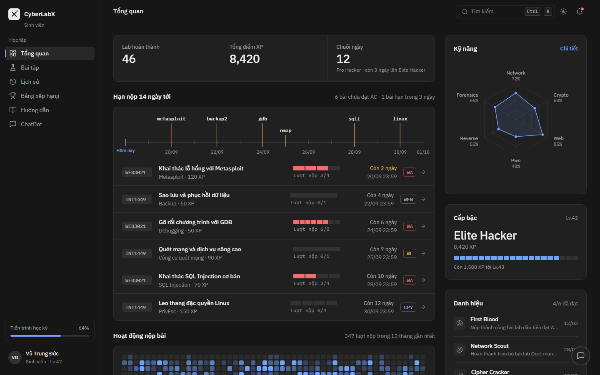
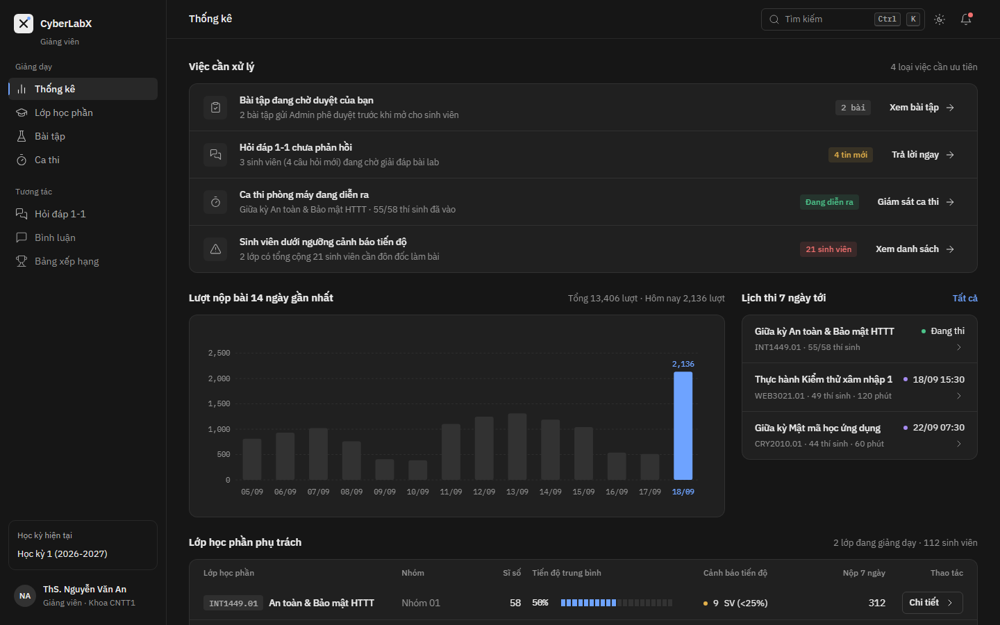
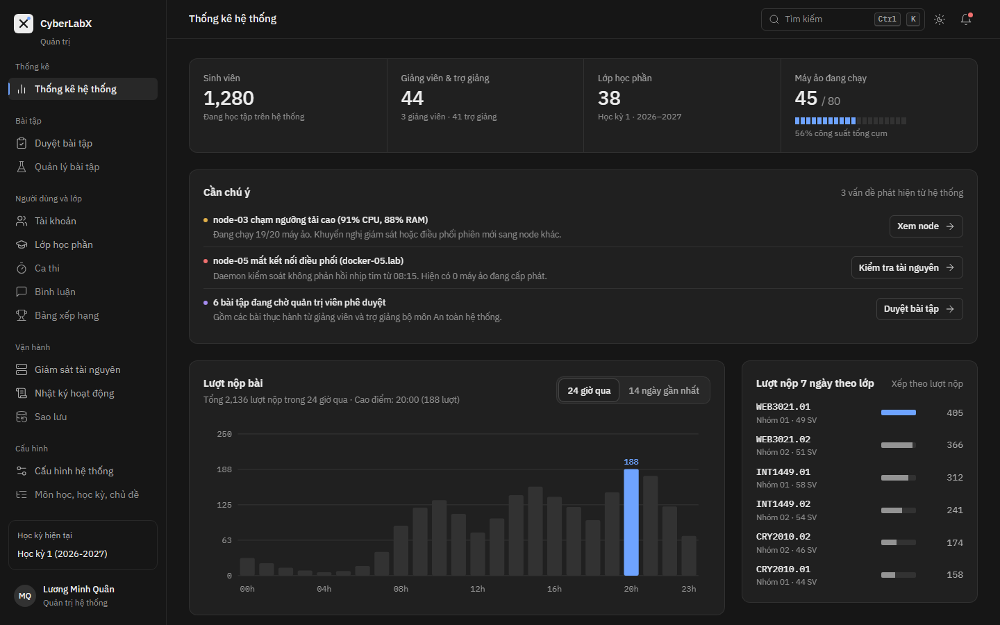
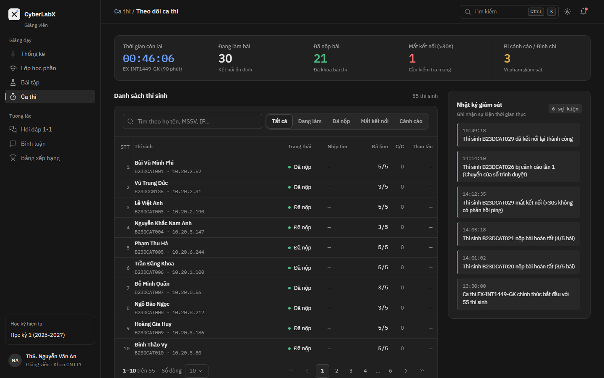
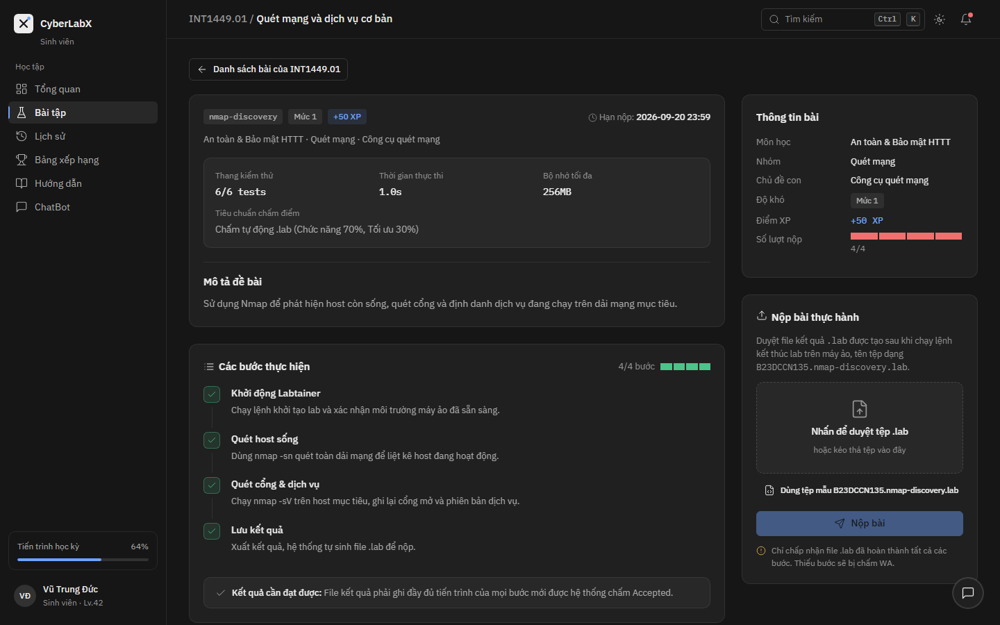
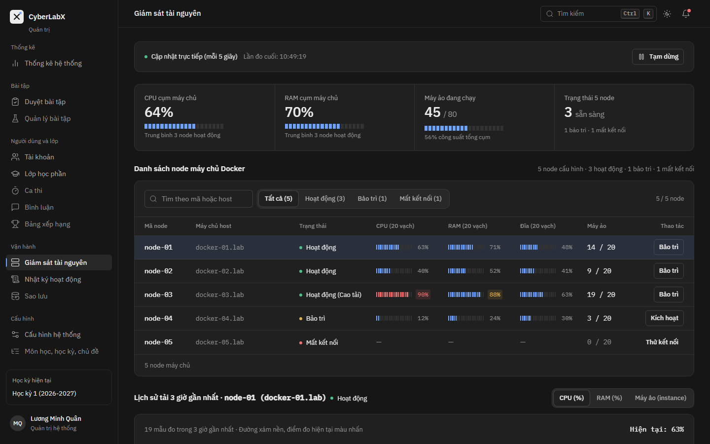

# CyberLabX — thiết kế lại giao diện

Bản prototype tĩnh (HTML, CSS, JavaScript thuần, không cần build) thiết kế lại toàn bộ giao diện của CyberLabX, hệ thống thực hành và tự động chấm bài lab an toàn thông tin. Gồm **4 vai trò** (Sinh viên, Giảng viên, Trợ giảng, Admin), **28 màn hình**, giao diện sáng và tối, một hệ thiết kế dùng chung.

> English: a dependency-free static prototype of a full UI redesign for CyberLabX (an auto-graded security-lab platform): 4 roles, 28 screens, light and dark themes, one shared design system.

| Sinh viên: Tổng quan | Giảng viên: Thống kê |
|---|---|
|  |  |
| **Admin: Thống kê hệ thống** | **Giảng viên: Theo dõi ca thi** |
|  |  |
| **Sinh viên: Chi tiết bài tập và nộp bài** | **Admin: Giám sát tài nguyên** |
|  |  |

## Chạy thử

Cần Node.js 18 trở lên (chỉ để mở máy chủ tĩnh; prototype không có phụ thuộc nào) và kết nối mạng để tải font IBM Plex và icon Lucide từ CDN.

```bash
node huong-dan-chay/serve.js        # http://localhost:5200
```

Hoặc bấm đúp `index.html`. Hướng dẫn đầy đủ (xem trên điện thoại, chụp ảnh kiểm tra, lỗi thường gặp): [`huong-dan-chay/README.md`](huong-dan-chay/README.md).

Đổi sáng/tối bằng nút trên thanh trên cùng hoặc thêm `?theme=light` / `?theme=dark` vào địa chỉ. Bấm `Ctrl K` để mở bảng tìm kiếm nhanh (trang, bài tập, lớp, sinh viên).

## Hướng thiết kế

**Sổ tay phòng lab.** Yên tĩnh, chính xác, nhiều dữ liệu, ít trang trí. Mọi chi tiết đặc trưng lấy từ nghiệp vụ chấm bài, không theo mốt giao diện.

| Chi tiết | Ý nghĩa nghiệp vụ |
|---|---|
| Dấu chấm bài `AC` `WA` `WF` `WFN` `CPY` | Kết quả bài nộp, viền mảnh và chữ monospace như dấu đóng trên phiếu chấm |
| Thanh vạch | Đại lượng đếm được: lượt nộp đã dùng / tối đa, bước của bài lab, mức tải máy chủ |
| Thước hạn nộp | Trục 14 ngày có các hạn nộp thật của sinh viên |
| Bảng sổ cái | Nhật ký và lịch sử: cột số thứ tự monospace, đường kẻ lề |
| Bảng lệnh `Ctrl K` | Tìm nhanh bằng bàn phím, không dấu cũng tìm được |

Nguyên tắc: nền xám-đen thuần (không ngả xanh hay tím), một màu nhấn xanh mực, màu còn lại chỉ để báo trạng thái; không glow, không đổ bóng, không gradient, không kính mờ; chữ IBM Plex (có đủ dấu tiếng Việt); bo góc chặt có bậc (4, 6, 10, 12); chuyển động ngắn, một đường cong, chỉ `opacity` và `transform`.

## Vai trò và màn hình

| Vai trò | Thư mục | Việc ưu tiên ở đầu trang | Màn hình |
|---|---|---|---|
| Sinh viên | `/` | Bài sắp đến hạn, lượt nộp còn lại | Tổng quan, Bài tập, Lịch sử, Bảng xếp hạng, Hướng dẫn, ChatBot, Tài khoản, Đăng nhập |
| Giảng viên | `teacher/` | Việc cần xử lý, sinh viên dưới ngưỡng cảnh báo | Thống kê, Lớp học phần, Chi tiết lớp, Bài tập, Ca thi, Theo dõi ca thi, Hỏi đáp 1-1 |
| Trợ giảng | `ta/` | Như Giảng viên, không có Hỏi đáp, không xóa bài, không sửa ngưỡng | Thống kê, Lớp học phần, Chi tiết lớp, Bài tập, Ca thi, Theo dõi ca thi |
| Admin | `admin/` | Sức khỏe hệ thống, hàng đợi duyệt, bất thường | Thống kê hệ thống, Giám sát tài nguyên, Tài khoản, Lớp học phần, Duyệt bài tập, Nhật ký hoạt động, Cấu hình hệ thống |

Trang của Trợ giảng sinh từ trang Giảng viên bằng `tools/build-ta.js`; hành động Trợ giảng không có được ẩn theo `data-role`. Mục điều hướng chưa có trang hiện mờ và không bấm được.

## Cấu trúc

```
index.html              cổng duyệt thiết kế: chọn vai trò, xem mọi màn hình
*.html                  màn hình Sinh viên
teacher/  ta/  admin/   màn hình theo vai trò
assets/
  tokens.css            màu, bo góc, chữ (sáng và tối)
  base.css              reset, khung ứng dụng, sidebar, topbar
  components.css        nút, thẻ, chip, bảng, tab, form, phân trang, bảng lệnh
  shell.js              dựng sidebar, topbar, Ctrl K; tiện ích CLXUI
  charts.js             radar, bản đồ nhiệt (SVG thuần)
  data*.js              dữ liệu mẫu (sinh từ hạt giống cố định, số liệu khớp nhau giữa các trang)
skills/cyberlabx-ui/    chuẩn giao diện cho người và agent (SKILL.md, mã mẫu thành phần)
tools/                  script hỗ trợ (sinh trang Trợ giảng, kiểm tra tĩnh)
huong-dan-chay/         hướng dẫn chạy, máy chủ tĩnh không phụ thuộc
docs/preview/           ảnh xem trước
```

## Hệ thiết kế

Đọc [`skills/cyberlabx-ui/SKILL.md`](skills/cyberlabx-ui/SKILL.md) trước khi thêm hoặc sửa giao diện. Đây là chuẩn duy nhất cho người lẫn agent (`AGENTS.md`, `CLAUDE.md`, `GEMINI.md` đều trỏ về đó). Mã mẫu từng thành phần: [`skills/cyberlabx-ui/references/components.md`](skills/cyberlabx-ui/references/components.md).

Thêm một trang mới: sao `dashboard.html` (hoặc một trang cùng vai trò), đặt `data-role`, `data-page`, `data-title`, viết nội dung trong `<main id="content">`. Chỉ dùng token và class có sẵn; thiếu thành phần thì thêm vào `assets/components.css` rồi ghi vào tài liệu.

## Chất lượng

- Hai giao diện sáng và tối, đủ ở mọi màn hình; bố cục dùng được từ 390px đến 1920px.
- Truy cập: dùng được hoàn toàn bằng bàn phím, vòng focus rõ, vùng bấm tối thiểu 32px, nhãn tiếng Việt cho nút chỉ có icon, tương phản chữ đạt 4.5:1, bảng lệnh và hộp thoại có bẫy focus.
- Không có lỗi console ở cả 28 trang; dữ liệu động luôn được escape trước khi vẽ.
- Mọi danh sách dài có phân trang theo ngữ cảnh; hành động hủy, xóa, đình chỉ có xác nhận, và bắt buộc nhập lý do khi cần.

Kiểm tra tĩnh trước khi gửi thay đổi: `node tools/lint-pages.js`.

## Quy ước làm việc

- Nhánh: `feat/<phạm-vi>`, `fix/<phạm-vi>`, `docs/<phạm-vi>`; không đẩy trực tiếp lên `main`.
- Commit theo [Conventional Commits](https://www.conventionalcommits.org/): `feat(admin): …`, `fix(student): …`, `docs: …`.
- Ngôn ngữ giao diện: tiếng Việt có dấu; tên file, thư mục, hàm bằng tiếng Anh.

## Trạng thái

Đây là prototype để duyệt thiết kế. Dữ liệu là dữ liệu mẫu, chưa gọi API. Việc chuyển sang ứng dụng React trong `client/` của CyberLabX là bước tiếp theo: token trong `assets/tokens.css` ánh xạ trực tiếp sang bộ token hiện có, thành phần dựng lại theo `components.css`.

## Ghi công

Phương pháp chống "AI slop" tham khảo [unslop](https://github.com/heydamir/unslop) (Damir Sokolovsky, CC BY 4.0). Chữ [IBM Plex](https://github.com/IBM/plex) (SIL OFL 1.1). Icon [Lucide](https://lucide.dev) (ISC).
